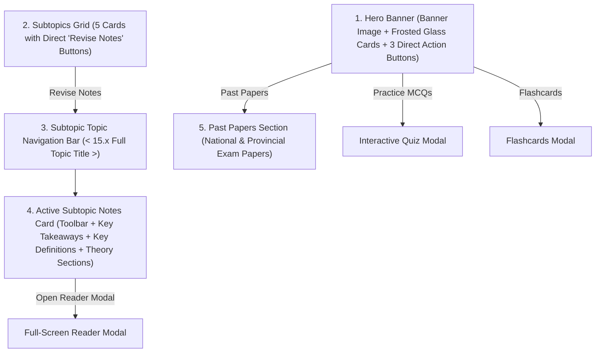

# Unit Page Specification & Architecture

## 1. Executive Summary & Purpose
The **Unit Page** (`UnitPage.jsx`) is the primary learning portal for every science unit in the G.C.E. Ordinary Level Science Revision Hub. It provides a modern, distraction-free, textbook-aligned revision environment for Sri Lankan students (covering Grades 10 & 11 in both English and Sinhala mediums).

This specification documents the current architecture, UI components, state management, design tokens, and user experience flows based on recent refinements.

---

## 2. Core Philosophy & Design Guidelines
1. **Curriculum Alignment**: All contents, subtopics, and terminology strictly mirror the National Institute of Education (NIE) official textbooks (`ENG11U15.pdf`, `SIN11U15.pdf`, etc.).
2. **Frosted Glass Aesthetic**: Modern semi-transparent glassmorphism (`bg-white/30 backdrop-blur-md border border-white/30`) over high-resolution unit hero artwork with high-contrast text (`text-slate-900`, `text-slate-700`).
3. **Zero Clutter / Action-Oriented**: Removed redundant summary banners, badge counts, and inline quiz blocks in favor of high-yield subtopic notes and direct-launch hero action buttons.
4. **Readable Typography (No Raw LaTeX)**: All scientific equations, chemical reactions, and formulas render cleanly in human-readable Unicode (e.g., `CO₂`, `NO₃⁻`, `──>`) via `<FormattedContent />` and `<InlineText />`.
5. **Dual Medium Support**: Instant bilingual switching (English / සිංහල) globally and locally within the revision guide.

---

## 3. High-Level Page Structure & Visual Hierarchy



---

## 4. Component Breakdown & Specifications

### 4.1 Unit Hero Section
- **Background Visuals**:
  - Optional high-res illustration banner (e.g. `/images/hero-biosphere-banner.png` defined in `heroBannerImage` of `unitsData.js`).
  - Subtle `bg-white/10` wash to keep illustrations vibrant and visible without dark tint overlays.
- **Top Quick Navigation Pill**:
  - `All Topics` (`සියලු පාඩම්`): Navigates back to the curriculum dashboard.
  - `Prev Lesson` (`පෙර පාඩම`): Navigates to previous unit.
  - `Next Lesson` (`ඊළඟ පාඩම`): Navigates to next unit.
  - `Share` (`බෙදාගන්න`): Copies unit URL with clipboard confirmation toast.
  - Styled with frosted glass: `bg-white/30 backdrop-blur-md border border-white/30`.
- **Unit Title & Overview Card**:
  - Frosted container (`bg-white/30 backdrop-blur-md border border-white/30 shadow-xs`).
  - Unit title (Sinhala / English based on active language, with alternate language subtitle in italic).
  - Concise syllabus overview paragraph.
- **Hero Direct Action Buttons (3 Symmetrical Action Cards)**:
  - Width: `min-w-[210px] sm:min-w-[240px]` with frosted glass styling (`bg-white/30 hover:bg-white/50 backdrop-blur-md border border-white/30 rounded-2xl px-6 py-4.5`).
  - **No count numbers** (clean, text + icon design).
  1. **Practice MCQs** (`HelpCircle` icon, purple theme):
     - Action: Immediately launches the interactive quiz modal via `onOpenQuiz(currentUnit)`.
  2. **Practice Flashcards** (`Layers` icon, blue theme):
     - Action: Immediately launches the flashcards modal via `onOpenFlashcards(currentUnit)`.
  3. **Past Papers** (`FileText` icon, emerald theme):
     - Action: Smooth-scrolls down to `#past-papers`.

---

### 4.2 Subtopics Overview Grid (`#subtopics`)
- **Direct Entry**: Top section title banner has been removed so students transition immediately from hero actions into subtopic browsing.
- **Card Layout**: Responsive 1 / 2 / 3 column grid (`grid-cols-1 md:grid-cols-2 lg:grid-cols-3 gap-5`).
- **Card Elements**:
  - Subtopic number badge (`15.1`, `15.2`, etc.).
  - `Syllabus Core` (`විෂය නිර්දේශගතයි`) badge.
  - Bilingual topic title and description.
  - **Revise Notes Button** (`සටහන් කියවන්න`):
    - Handler: `handleReviseSubtopic(subtopic)`
    - Action: Activates the matching tab ID (`activeRevisionTabId`) and executes a smooth scroll directly to `#subtopic-nav-bar`.

---

### 4.3 Textbook Revision Guide (`UnitRevisionNotes.jsx`)
*Note: The redundant top header box ("Complete Unit 15 Textbook Revision Guide" card with core curriculum pillars) has been removed.*

#### 4.3.1 Subtopic Topic Navigation Bar (`#subtopic-nav-bar`)
- **Full-Width Topic Display**:
  - White rounded card (`bg-white rounded-2xl p-4 sm:p-5 shadow-xs border border-slate-200`).
  - Displays the full subtopic title in the active medium, alternate medium subtitle, unit badge (`15.1`), and progress badge (e.g. `Subtopic 1 of 5` / `5 න් 1 වන අනුමාතෘකාව`).
- **Interactive Navigation Buttons**:
  - **`<` (Previous)** on the left end: Navigates to previous subtopic. Disabled on the first subtopic.
  - **`>` (Next)** on the right end: Navigates to next subtopic. Disabled on the final subtopic.
  - Accessible hover tooltips display the adjacent subtopic names.

#### 4.3.2 Active Subtopic Revision Card (`#subtopic-revision-card`)
- **Card Toolbar**:
  - Displays textbook section pagination (e.g., `Section 15.1 (Pages 1-8)`).
  - **Local Language Toggle Pill**: `English | සිංහල` buttons allowing students to toggle notes medium on the fly without affecting the whole site.
  - **Open Reader Modal Button**: `Maximize2` button launching the full-screen reader modal.
- **Key Takeaways & Essential Concepts**:
  - Highlight container (`bg-emerald-50/40`) with numbered takeaways (`activeSubtopic.keyTakeaways`).
- **Key Definitions (Glossary)**:
  - Header: **"Key definitions"** (Sinhala: **"ප්‍රධාන අර්ථ දැක්වීම්"**).
  - Clean term and definition cards (`term`, `definition`).
  - *Exam Tip sub-boxes and Common Pitfalls sections have been eliminated for maximum clarity.*
- **Theory Sections & Embedded Diagrams**:
  - Formatted paragraphs rendered using `<FormattedContent text={section.content} />`.
  - Supports Markdown subheadings (`###`), bullet lists (`-`), numbered steps (`1.`), and bold emphasis (`**...**`).
  - Embedded diagrams with caption and hover-to-zoom overlays (`ZoomIn` lightbox modal).

---

### 4.4 Past Papers Section (`#past-papers`)
- **Curated Exam Papers**: National G.C.E. O/L Past Papers (2021–2023) and Provincial Target Papers.
- **Filter Controls**: Year, Paper Part (Part I MCQ / Part II Structured Essay), and Language Medium.
- **Action**: One-click download with animated toast confirmation feedback.

---

### 4.5 Modals & Overlays
1. **Interactive Quiz Modal**:
   - Triggered from Hero button (`Practice MCQs`).
   - Timed examination simulator with instant rationales and score analysis.
2. **Flashcards Modal**:
   - Triggered from Hero button (`Practice Flashcards`).
   - Interactive flip cards for rapid memorization of key terms and concepts.
3. **Full-Screen Subtopic Reader Modal**:
   - Distraction-free reading view with font size adjustment and print support.
4. **Lightbox Image Lightbox**:
   - Full-resolution preview for textbook diagrams and charts with ESC key closing.

---

## 5. Data Architecture & File Organization

```
Science/
├── public/
│   └── images/
│       └── hero-biosphere-banner.png       # High-res hero banner asset
├── src/
│   ├── components/
│   │   ├── UnitPage.jsx                   # Main unit page container & hero
│   │   ├── UnitRevisionNotes.jsx          # Textbook notes & subtopic navigator
│   │   └── FormattedContent.jsx           # Clean Unicode & Markdown parser
│   ├── data/
│   │   ├── unitsData.js                   # Unit metadata, descriptions, banner paths
│   │   └── subtopicNotes/
│   │       ├── index.js                   # Subtopic note exports & getters
│   │       ├── g11-u15.js                 # English comprehensive textbook notes
│   │       └── g11-u15-si.js              # Sinhala comprehensive textbook notes
└── docs/
    └── UnitPage_Specification.md          # This architectural specification
```

### 5.1 Unit Metadata Schema (`unitsData.js`)
```javascript
{
  id: "g11-u15",
  unitNumber: 15,
  grade: 11,
  discipline: "Biology",
  titleEn: "Biosphere",
  titleSi: "ජීවගෝලය",
  descriptionEn: "Explore the biosphere...",
  descriptionSi: "ජීවගෝලයේ සංවිධාන මට්ටම්...",
  heroBannerImage: "/images/hero-biosphere-banner.png",
  subtopics: [
    {
      id: "15.1",
      titleEn: "Organizational Levels & Interactions of Biosphere",
      titleSi: "ජීවගෝලයේ සංවිධාන මට්ටම් සහ අන්තර්ක්‍රියා",
      descriptionEn: "...",
      descriptionSi: "..."
    },
    // ...
  ]
}
```

### 5.2 Subtopic Notes Schema (`subtopicNotes/g11-u15.js`)
```javascript
{
  unitId: "g11-u15",
  subtopics: [
    {
      id: "15.1",
      textbookSection: "Section 15.1 (Pages 1 - 8)",
      titleEn: "Organizational Levels & Interactions of Biosphere",
      titleSi: "ජීවගෝලයේ සංවිධාන මට්ටම් සහ අන්තර්ක්‍රියා",
      keyTakeaways: [ "Takeaway 1", "Takeaway 2" ],
      keyDefinitions: [
        {
          term: "Biosphere (ජීවගෝලය)",
          definition: "The global ecological system integrating all living beings..."
        }
      ],
      sections: [
        {
          heading: "15.1.1 Levels of Organization",
          content: "### Hierarchy\n- **Organism**: Single individual\n- **Population**: ...",
          diagram: {
            url: "/images/units/g11-u15/levels.png",
            caption: "Organizational hierarchy of the biosphere"
          }
        }
      ]
    }
  ]
}
```

---

## 6. How to Replicate / Create a New Unit Page
To create or adapt another Science unit (e.g., `g11-u14`, `g10-u1`) according to this standard:

1. **Add Unit Entry in `src/data/unitsData.js`**:
   - Specify unit metadata, dual-language title, description, and list of subtopics.
   - If a custom artwork banner is available, supply `heroBannerImage: "/images/hero-[unit].png"`.

2. **Author Subtopic Notes in `src/data/subtopicNotes/`**:
   - Create `[unit-id].js` (English) and `[unit-id]-si.js` (Sinhala).
   - Follow the schema: `keyTakeaways`, `keyDefinitions` (`term`, `definition`), and `sections` with `heading`, `content`, and optional `diagram`.
   - **Important**: Format chemical equations with Unicode arrows (`──>`) and subscripts (`CO₂`, `H₂O`). Do not use raw LaTeX dollar delimiters (`$`, `$$`).

3. **Register in `src/data/subtopicNotes/index.js`**:
   - Import the English and Sinhala files and add them to `unitRevisionDataRegistry`.

4. **Verify Page Features**:
   - Ensure the Hero section displays the 3 direct action buttons: **Practice MCQs**, **Practice Flashcards**, and **Past Papers**.
   - Check that clicking **Revise Notes** on any subtopic card scrolls directly to `#subtopic-nav-bar`.
   - Verify that `<` and `>` navigate smoothly between subtopics.
   - Verify that the language toggle switches between English and Sinhala notes accurately.
   - Run `npm run lint` and `npm run build` to confirm zero errors.
